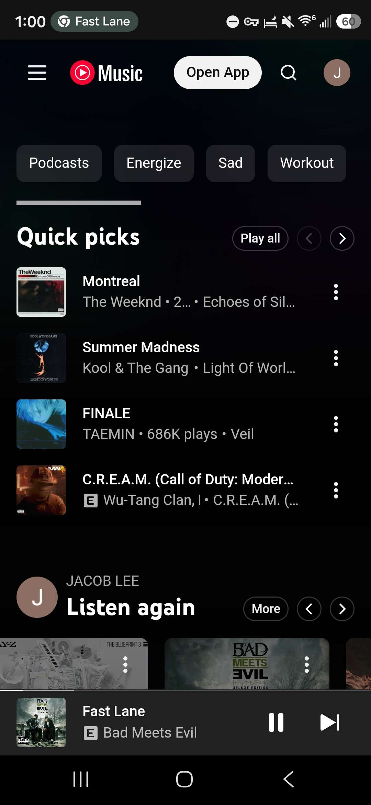

# Taro Music

Taro Music turns the YouTube Music website into a proper mobile app.

<table width="75%">
  <tr>
    <th>
Before
</th>
    <th>
After
</th>
  </tr>
  <tr>
    <td align="center"></td>
    <td align="center"></td>
  </tr>
  <tr>
    <td align="center"></td>
    <td align="center"></td>
  </tr>
  <tr>
    <td align="center"></td>
    <td align="center"></td>
  </tr>
</table>

## Features

- No ads
- Plays in the background
- Lock screen and notification controls
- Mobile-friendly UI
  - Swipe gestures
  - Bottom navigation bar
  - Full screen (draws behind the Android status bar and navigation buttons)

## How it works

- Wraps [music.youtube.com](https://music.youtube.com/) in an Android WebView.
- Injects JavaScript to block ads and adapt the page for mobile.

## Disclaimer

- Taro Music is an unofficial app and is not made by, or affiliated with, Google or YouTube. It modifies the YouTube Music website; you use your own account and YouTube's terms still apply.
- It depends on how YouTube Music's page is built today. If YouTube redesigns the site, some gestures or the tab bar may break until the app is updated.
- With the keyboard open, text boxes low on the screen (such as the "New playlist" box) can end up behind it.

## License

[GNU General Public License v3.0](LICENSE): free software, copyleft. If you distribute builds (including on a store), the GPL requires you to make the corresponding source available under the same license.
