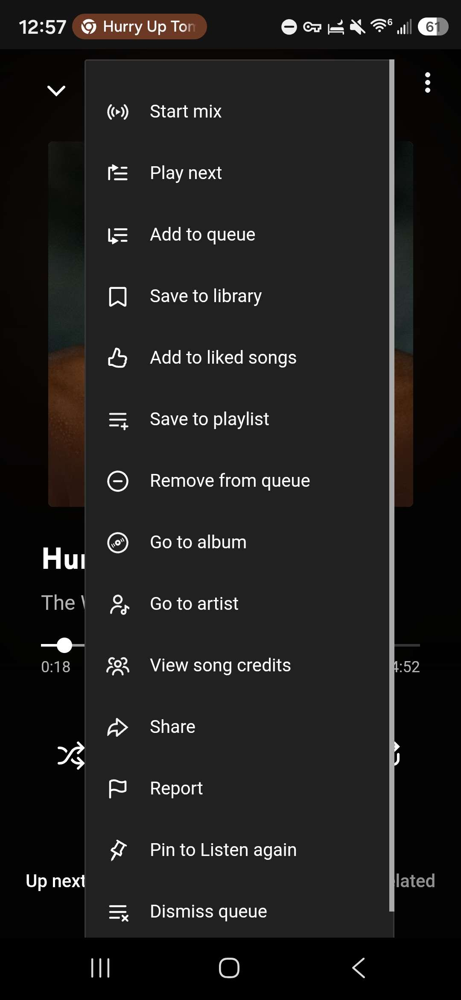
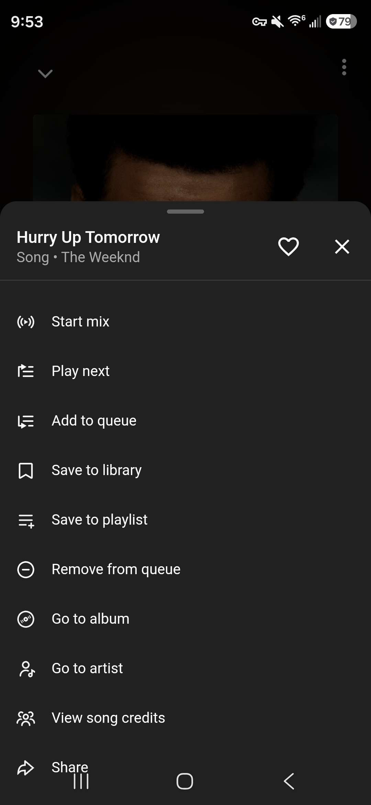

# Taro Music

Taro Music turns the YouTube Music website into a proper mobile app.

<table>
  <tr>
    <th>
Before
</th>
    <th>
After
</th>
    <th>
Before
</th>
    <th>
After
</th>
  </tr>
  <tr>
    <td align="center"></td>
    <td align="center"></td>
    <td align="center"></td>
    <td align="center"></td>
  </tr>
  <tr>
    <td align="center"></td>
    <td align="center"></td>
    <td align="center" colspan="2"></td>
  </tr>
</table>

## Features

- No ads
- Plays in the background
- Lock screen and notification controls
- Mobile-friendly UI
  - Swipe gestures
  - Pull down to refresh Home, Explore and Library
  - Bottom navigation bar
  - Full screen (draws behind the Android status bar and navigation buttons)

## Download

Taro Music is Android only. Get the latest `taro-music-<version>.apk` from the [GitHub Releases](https://github.com/jacob-e-lee/taro-music/releases/latest) page and open it on your phone. Android will ask you to allow installing apps from your browser or file manager.

To update, download the newer APK and install it over the old one. You stay signed in.

## How it works

- Wraps [music.youtube.com](https://music.youtube.com/) in an Android WebView.
- Injects JavaScript to block ads and adapt the page for mobile.
- Reports the playing track to Android, so the lock screen, notification and headset buttons work.

For the full story of what was changed and why, see the [wiki page](docs/wiki/Home.md).

## Disclaimer

- Taro Music is an unofficial app and is not made by, or affiliated with, Google or YouTube. It modifies the YouTube Music website; you use your own account and YouTube's terms still apply.
- It depends on how YouTube Music's page is built today. If YouTube redesigns the site, some gestures or the tab bar may break until the app is updated.
- With the keyboard open, text boxes low on the screen (such as the "New playlist" box) can end up behind it.

## License

[GNU General Public License v3.0](LICENSE): free software, copyleft. If you distribute builds (including on a store), the GPL requires you to make the corresponding source available under the same license.
