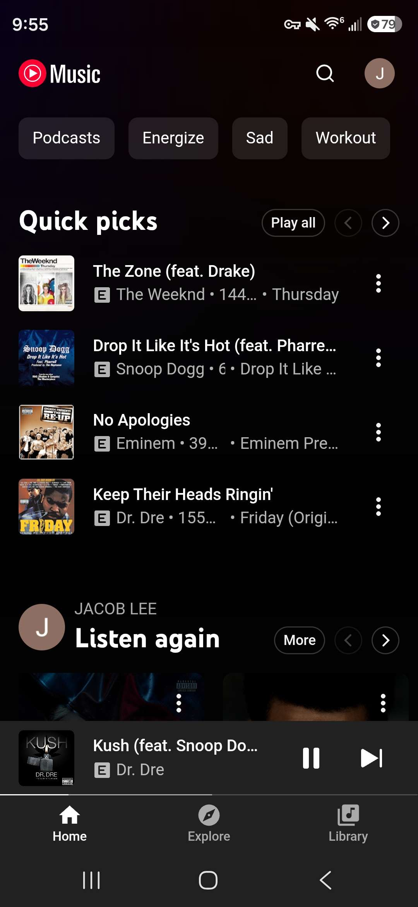
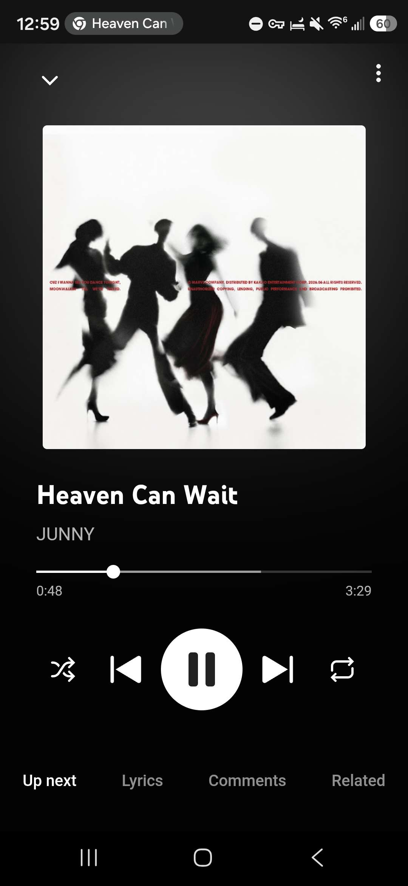
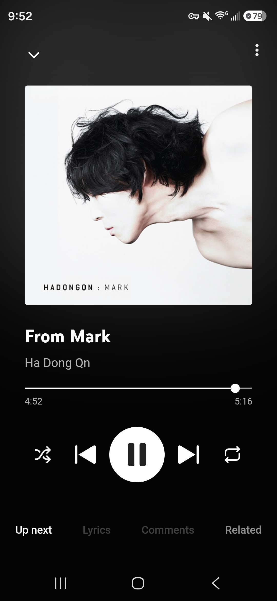
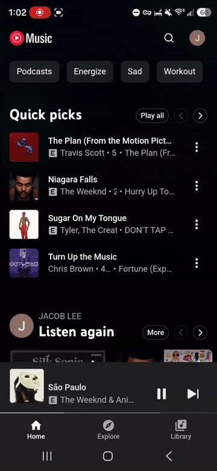

# Taro Music

Taro Music turns the YouTube Music website into a proper mobile app.

<table>
  <tr><th>Before</th><th>After</th></tr>
  <tr>
    <td></td>
    <td></td>
  </tr>
  <tr>
    <td></td>
    <td></td>
  </tr>
  <tr>
    <td></td>
    <td></td>
  </tr>
</table>

## What you get

- No ads
- Plays in the background
- Lock screen and notification controls.
- Improved UI/UX for mobile devices
  - Swipe controls
  - Navigation Bar
  - Full screen (renders behind Android status bar and navigation buttons)

## How it works

- Wrap [https://music.youtube.com/](https://music.youtube.com/) in Android webview.
- Inject javascript to block ads and optimize the frontend UI/UX for mobile

## Disclaimer

- Taro Music is an unofficial app and is not made by, or affiliated with, Google or YouTube. It modifies the YouTube Music website; you use your own account and YouTube's terms still apply.
- It depends on how YouTube Music's page is built today. If YouTube redesigns the site, some gestures or the tab bar may break until the app is updated.
- With the keyboard open, text boxes low on the screen (such as the "New playlist" box) can end up behind it.

## License

[GNU General Public License v3.0](LICENSE): free software, copyleft. If you distribute builds (including on a store), the GPL requires you to make the corresponding source available under the same license.
